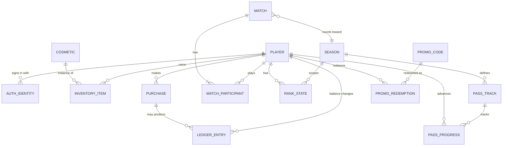

# 0005. Data: PostgreSQL source of truth, Redis for ephemeral state

Status: Accepted
Date: 2026-10-25
Issue: #10

## Context
The game holds currency, purchases, inventory and ranks, which must never be lost or double-granted, and ephemeral state (who is online, who is queued, which node hosts a room) that must be fast and may be rebuilt. Money-like data needs an audit trail.

## Decision

### PostgreSQL: source of truth
Accounts, auth identities, inventory, currency ledger, purchases, match results, ranks and seasons, pass progress, promo codes, and admin-managed config.
- Currency is an append-only ledger. A balance is derived from, or reconciled against, ledger entries; a grant is one transaction that writes the ledger entry and its effect together.
- Purchases are recorded with the store transaction id under a unique constraint, so a repeated receipt is harmless (ADR 0007).
- Schema changes are versioned migrations reviewed in PRs.

### Redis: ephemeral and coordination
Presence, matchmaking queues, room routing (room id to node), session tokens for resume, rate-limit counters, short-lived locks. Loss of Redis degrades matchmaking and presence but never loses balances or purchases. Recovery of rooms in progress is defined in the server spec.

### Data model (entity level)

Column-level design belongs to the migration PRs. Cosmetic rarity, prices, pass rewards and rank thresholds come from admin config (ADR 0006) and are referenced by id; they are not hard-coded.

## Alternatives considered and why rejected
- Redis as the primary store: fast, but durability and transactional guarantees are insufficient for currency and purchases.
- MongoDB or another document store: flexible schema, but the ledger, inventory and uniqueness constraints are relational and need multi-row transactions.
- PostgreSQL only: simpler operations. Rejected because matchmaking queues, presence and rate limits have write rates and expiry semantics that would load the primary database, and cross-node room routing needs a low-latency shared store.
- In-process state only: breaks with more than one node and loses queues on restart.
- Managed game backend storage (for example Nakama storage): ties the schema to a vendor model, see ADR 0003.
- Event sourcing for everything: rejected as speculative; only currency uses an append-only ledger.

## Consequences
- Easier: strong integrity for money-like data, a simple audit trail, familiar tooling, SQL for balance and abuse analysis.
- Harder: two stores to operate, back up and monitor. Redis state must be rebuildable and keys carry TTLs. Hot-path writes (match results, ledger) need batching decisions measured under load (ADR 0008).
- Each match records the config version it used, so disputes can be replayed against the right numbers.
