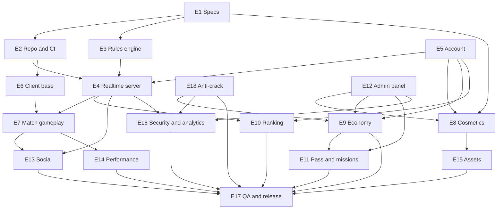

# Roadmap, dependencies and release gate

Plan source: GitHub milestones M0 to M6 and epics E1 to E18 (issue #1 and the epic issues). This file fixes the order, the dependencies between epics and the definition of done. It carries no dates; none were decided. Issue lists live in the milestone pages, not here.

## 1. Milestones

Every issue belongs to exactly one milestone. A milestone is done only when its exit criterion holds and every issue in it is closed.

| M | Milestone | Goal | Epics | Page |
|---|---|---|---|---|
| M0 | Foundation: docs and repo | Specs, repo, CI and architecture fixed so build work can start | E1 (specs), E2 (repo, CI/CD, infra) | [milestone/1](https://github.com/Alievs-corp/hypedomino/milestone/1) |
| M1 | Engine: rules and bot | One pure, fully tested rules package and a bot | E3 (rules engine) | [milestone/2](https://github.com/Alievs-corp/hypedomino/milestone/2) |
| M2 | Playable online | Two to four real players finish a match on a device against the server | E4 (realtime, rooms, matchmaking), E5 (account, login, profile), E6 (Unity client base), E7 (match table and gameplay), E18 (anti-crack and client integrity) | [milestone/3](https://github.com/Alievs-corp/hypedomino/milestone/3) |
| M3 | Meta: cosmetics and economy | Owned, equippable cosmetics and a server-authoritative economy with real-money purchases | E8 (cosmetics), E9 (economy, shop, IAP, promo) | [milestone/4](https://github.com/Alievs-corp/hypedomino/milestone/4) |
| M4 | Live-ops: ranking, pass, admin, social | Everything tunable and operable without a client release | E10 (ranking, seasons), E11 (pass, missions, medals, daily rewards), E12 (admin panel), E13 (social) | [milestone/5](https://github.com/Alievs-corp/hypedomino/milestone/5) |
| M5 | Polish: effects, assets, performance | Final look, content production and measured performance | E14 (settings, performance), E15 (asset production), E16 (security, anti-cheat, analytics, compliance) | [milestone/6](https://github.com/Alievs-corp/hypedomino/milestone/6) |
| M6 | Release | QA, beta, stores, legal, launch | E17 (QA, beta, stores, release) | [milestone/7](https://github.com/Alievs-corp/hypedomino/milestone/7) |

Epic issues: E1 #1, E2 #17, E3 #29, E4 #42, E5 #54, E6 #64, E7 #77, E8 #91, E9 #100, E10 #111, E11 #122, E12 #133, E13 #149, E14 #156, E15 #165, E16 #180, E17 #189, E18 #200. This roadmap is #16, a sub-issue of E1.

Some issues sit in a later milestone than their epic because they gate it. For example #212 (red team) belongs to E18 but is scheduled in M6, and #195 (legal) and #198 (content gate) are in M6 under E17.

### Exit criteria

Each line is checkable by a command, a document or a recorded measurement.

| M | Exit criterion |
|---|---|
| M0 | Every spec in `docs/` listed in E1 is merged, the rule ambiguities are confirmed by the owner (#3), `CI complete` is green on `main`, and the milestone has no open issue. |
| M1 | `go test ./server/internal/rules/...` passes the table-driven suite and every vector in `docs/rules-vectors/`; property/fuzz tests and benchmark (#39) run in CI; a bot (#40) finishes complete matches from a replay record (#41); the milestone has no open issue. |
| M2 | A recorded session shows a 1v1 and a 2v2 match played to the 365 target on a mid-tier reference device (`docs/performance.md`) against a deployed server, with login (#56, #57), reconnect (#45, #87) and AFK replacement by bot (#47); `docs/anti-cheat.md` (#201) is merged and the authoritative economy audit (#202) passes; the milestone has no open issue. |
| M3 | A sandbox purchase on each store is granted only after server-side receipt validation (#106, #204), is idempotent in the ledger (#101) and survives restore (#107); a promo code (#108) and a cosmetic can be redeemed, owned and equipped; abuse checks (#110, #211) have tests; the milestone has no open issue. |
| M4 | A ranking season and a pass season are created, run and closed purely from admin config (#115, #123, #140, #143); admin RBAC and audit log (#134) are active; remote config and flags (#145) change a tunable value without a client release; the milestone has no open issue. |
| M5 | Every client and server budget in `docs/performance.md` has a recorded passing measurement on the device matrix (#161, #162, #163, #164); the first asset sets ship through Addressables (#179); analytics, crash reporting, rate limiting and moderation are live (#181, #182, #184, #186); the milestone has no open issue. |
| M6 | The release gate in section 4 passes and the milestone has no open issue. |

## 2. Dependency graph (epic level)

An arrow `A --> B` means B cannot be finished before A. Edges are taken from the "Epic: #N" links and blocker references in issue bodies, reduced to epics, plus the architecture in `CLAUDE.md` (server authoritative, admin-managed config). Weak links are left out.

E12 is a dependency of E8, E9 and E11 although scheduled in M4: only its skeleton, catalogue CRUD and config surface (#134, #136, #139, #145) are needed first, not the whole panel. E18 starts in M2 because its authoritative-server rules shape E4, E5 and E9, and ends in M6 with the red team (#212).

### Critical path

E1 (specs, owner confirmation #3) -> E3 rules engine -> E4 realtime match -> E7 gameplay -> E9 economy -> E11 pass -> E14 performance campaign -> E17 release. The tail after features are complete is the longest: #161, #191, #198, #212.

### Known cross-epic blockers

- Rules engine before realtime match: the room state machine and AFK handling (#46, #47) need the engine and bot (#30 to #34, #40); the client renders and sends intents only.
- Auth before economy: wallet, ledger, purchases and inventory need an authenticated account and schema (#55, #57, #58, #61) before #101 and #106.
- Admin config before tunable features: shop packages (#139), reward bundles (#138), pass seasons (#140), ranking tiers (#143) and remote config (#145) must exist before the features that read them can ship values; no tunable number is hardcoded.
- Anti-crack before economy sign-off: #202, #204 and #208 gate #101, #106 and #110.
- Ranking needs the match pipeline and leaver rules: #48, #52, #112 and `docs/penalties.md`.
- Art direction (#166, #167) before any asset set (#169 to #178); the animated asset runtime (#93) before avatars, characters and boards (#94, #95, #97).
- Decision gates: issues labelled `status: needs-decision` are blocked on an owner decision and are not implemented around. #3 (confirmation of rule ambiguities) is such a gate for E3 and M1. At the time of writing no issue carries the label; check `gh issue list -l "status: needs-decision"` before starting work.

## 3. Priorities

Priority labels order work inside a milestone: p0 blocks the milestone, p1 should ship in it, p2 may move later but not past the release gate unless the owner decides. Use the milestone pages with the `priority:` label filter for the live list; this file does not duplicate it.

## 4. Release gate

All of the following hold on the release candidate commit. Scope is in the referenced issues, not repeated here.

1. All issues labelled `priority:p0` or `priority:p1` are closed. Check: `gh issue list --state open -l "priority:p0"` and `-l "priority:p1"` return nothing.
2. Performance budgets are measured and pass as defined in `docs/performance.md` on the device matrix (#191, #192, #161, #164).
3. Minimum content catalogue meets the content gate (#198, `docs/launch-content-gate.md`).
4. Legal documents are published and linked from the store pages and the app (#195, #187).
5. Anti-cheat red team passes with no open critical finding (#212), on top of `docs/anti-cheat.md` (#201).
6. Release checklist and runbook (#197, `docs/launch-runbook.md`) are completed; backup and restore were exercised (#188); closed beta (#193) and soft launch KPI tracking (#196) are done or explicitly waived by the owner in the issue.
7. `CI complete` is green on the release commit.

An unmeasured budget counts as failed. A waiver for any item needs an owner comment on the issue it concerns.
